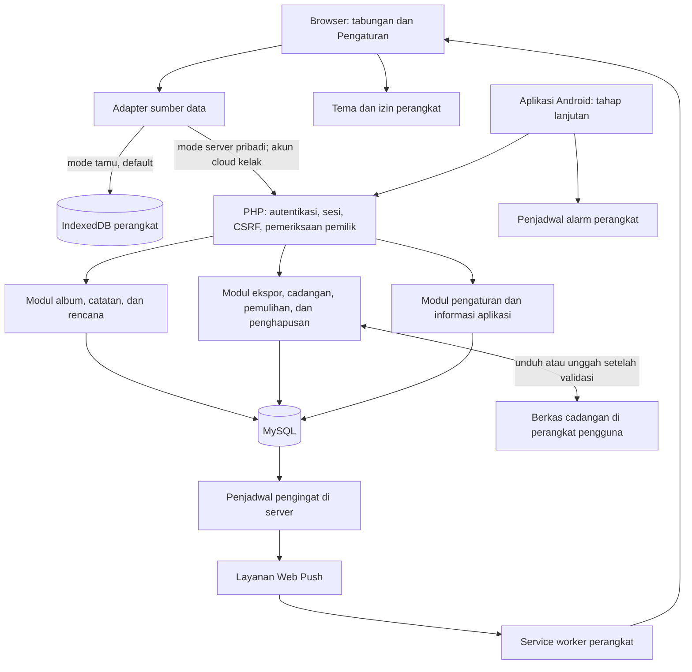
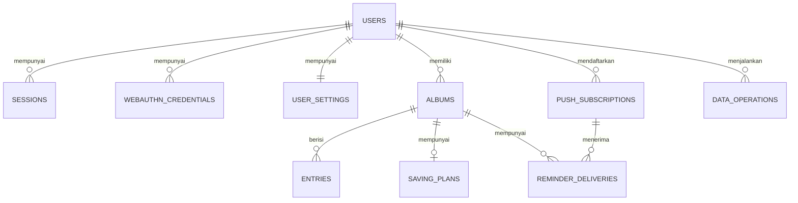
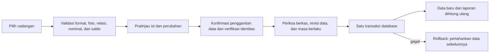

# Rancangan arsitektur Sadaku

Struktur kode browser sekarang memakai `assets/js/app.js`, `pages/`, `components/`, `domain/`, dan `data/`. Navbar/footer serta markup halaman tetap di `index.html`. Pengujian dipisahkan ke `tests/`; lihat [panduan struktur proyek](docs/PROJECT_STRUCTURE.md) untuk alur dependensi dan lokasi perubahan.

Pembaruan 17 November 2026: mode perangkat mendukung mata uang per album. Pilihan tersedia di sebelah kiri input target saat membuat album dan tersimpan atomik bersama album. `currency.js` menyediakan daftar mata uang, skala integer, dan format nominal dengan kode eksplisit; form menyimpan konteks mata uang masing-masing, terpisah dari mata uang form atau album lain. Wallet versi 3 menyimpan `albums[].currency`; properti mata uang wallet hanya menjadi pilihan awal album baru. Versi 1 dinormalisasi sebagai IDR dan versi 2 memakai mata uang wallet untuk tiap album, tanpa mengubah nominal. Mata uang album tersimpan tidak dapat diubah; catatan wajib mengikuti album. Ringkasan memisahkan total per mata uang; Statistik memfilter catatan menurut mata uang sebelum perhitungan. Cadangan versi 3 membawa kode/skala setiap album; versi 1 dan 2 tetap diterima. CSV campuran membawa kolom mata uang. Server PHP/MySQL lama tetap IDR. Tidak ada migrasi database utama, konversi kurs, terjemahan antarmuka, atau perubahan zona waktu pada tahap ini.

Verifikasi: 114 tes JavaScript lulus. Pemeriksaan mata uang mencakup alur DOM album campuran IDR/USD/EUR, nilai sen, rencana, pergantian album tujuan, statistik terpisah, CSV, kompatibilitas cadangan lama, persistensi, dan balapan dua tab. Build CSS, sintaks JavaScript, dan pemeriksaan whitespace lulus. Pemeriksaan visual browser nyata belum selesai karena akses kendali browser tidak tersedia/ditolak saat URL aktif tidak dapat dipastikan.

Status: **fondasi mode tamu diimplementasikan; akun cloud dan sinkronisasi masih rancangan**, 16 November 2026. Tidak ada migrasi database utama pada tahap ini.

## Arah rancangan

Pertahankan HTML/CSS/JavaScript, PHP, dan MySQL yang sudah digunakan. Backend tetap satu aplikasi, dengan modul terpisah untuk tabungan, autentikasi, pengelolaan data, pengaturan, dan pengingat. Pemisahan ini membantu pengujian dan pembatasan akses tanpa memerlukan layanan terpisah untuk setiap fitur.

Keputusan arah produk: pengguna langsung mencatat tanpa akun; akun cloud bersifat opsional untuk cadangan server dan sinkronisasi di tahap berikutnya. Data tamu disimpan per browser/origin, sedangkan data akun kelak wajib dipisahkan berdasarkan pemilik. Server pribadi lama belum merupakan akun cloud dan tetap dilindungi secara terpisah.

### Fondasi yang sudah diterapkan

- `wallet.js`: aturan domain lokal, ID, waktu WIB, saldo historis, serta validasi data.
- `local-store.js`: IndexedDB versi 1, satu snapshot wallet, transaksi baca/tulis, pemeriksaan revisi saat pemulihan, foto Blob dan lifecycle URL gambar.
- `data-source.js`: adapter UI; default lokal tanpa API, pilihan sumber server pribadi, serta ekspor/pemulihan cadangan. Pergantian sumber tidak melakukan sinkronisasi.
- `backup.js`: format JSON berversi, foto, validasi isi/ukuran, dan pemulihan penuh data perangkat setelah pratinjau/konfirmasi. Kredensial/sesi/push subscription tidak disertakan.
- `sw.js`: cache shell publik untuk pembukaan ulang offline. API dan data privat tidak dicache; notifikasi server tetap membuka sumber server.
- Pengaturan: status sumber data, cadangan, pemulihan, panduan, dan informasi penyimpanan. Akun/login, sinkronisasi konflik, passkey, alarm native, serta penghapusan seluruh data dari Pengaturan belum ditambahkan.

Penguncian database, guard per akun, dan tabel tambahan di bagian berikut merupakan **target tahap akun cloud**, bukan struktur yang sudah aktif. Caddy kini memisahkan shell publik dari API pribadi; validasi runtime container masih diperlukan sebelum deployment.

Verifikasi fondasi: 101 tes JavaScript lulus, termasuk IndexedDB, kuota gagal, data versi asing yang tetap dipertahankan, penulisan dua tab, foto, cadangan/pemulihan, alur DOM, dan pembatasan cache offline. Integrasi server lama lulus 117 pemeriksaan API lokal dan 113 pada simulasi mode produksi menggunakan MySQL sementara; pengiriman pengingat diuji dengan transport simulasi. Build CSS dan sintaks juga diperiksa. Data utama tidak dimigrasikan atau diubah oleh pengujian.

Pratinjau browser nyata gagal karena browser access host tidak tersedia. Pemeriksaan DOM menggunakan jsdom tidak menggantikan pemeriksaan visual atau kompatibilitas IndexedDB/service worker pada browser perangkat sebenarnya. Docker/Caddy tidak tersedia dalam lingkungan ini, sehingga autentikasi container dan pembukaan offline di perangkat nyata masih perlu diverifikasi sebelum rilis.

## Skema sistem yang dituju

Browser, database, dan penjadwal pengingat sudah memiliki implementasi dasar. Autentikasi aplikasi, pengelolaan cadangan melalui UI, dan aplikasi Android merupakan pekerjaan baru. Diagram menunjukkan sistem tujuan, bukan klaim bahwa semua komponennya sudah aktif.

## Pembagian tanggung jawab

| Modul | Tanggung jawab | Kondisi sekarang |
| --- | --- | --- |
| Tabungan | CRUD album/catatan, validasi saldo historis, jadwal menabung | Sudah ada; pertahankan perilakunya |
| Identitas dan akses | Login, logout, sesi, pemilik data, verifikasi ulang tindakan sensitif, pemulihan akses | Belum ada autentikasi akun di aplikasi; konfigurasi produksi memakai HTTP Basic di Caddy |
| Pengelolaan data | Ekspor seluruh catatan, cadangan lengkap, pratinjau pemulihan, pemulihan atomik, hapus data tabungan | CSV terfilter sudah ada; fungsi lainnya baru |
| Pengaturan | Tema, status perangkat, informasi versi, bantuan, privasi, tautan pengembang | Tema/notifikasi/tautan dasar sudah ada; konten dan susunan perlu dilengkapi |
| Pengingat | Langganan per perangkat, jadwal, retry, deduplikasi, penghentian saat target tercapai | Sudah ada; perlu pengujian perangkat dan operasi hosting nyata |
| Akses perangkat | Passkey dan, bila diperlukan, alarm Android | Memerlukan implementasi baru sesuai kemampuan platform |

## Identitas dan kepemilikan data

Untuk satu pemilik, buat akun awal melalui proses administrasi/CLI tanpa pendaftaran publik. Gunakan sesi server dengan cookie HttpOnly, Secure pada HTTPS, kedaluwarsa, logout, dan kemampuan mencabut sesi. Sediakan pembatasan percobaan login serta jalur pemulihan akses. Verifikasi ulang identitas sebelum pemulihan atau penghapusan data.

CSRF yang sekarang tersedia tetap dipertahankan, tetapi token CSRF tidak menggantikan autentikasi. Semua endpoint data, gambar album, dan unduhan cadangan harus memeriksa sesi serta kepemilikan di server. Sesi tidak disimpan sebagai token permanen di localStorage.

Jika autentikasi aplikasi menggantikan HTTP Basic, ubah konfigurasi Caddy setelah seluruh jalur privat terlindungi dan proses login/pemulihan diuji. Hindari membiarkan endpoint privat terbuka selama perpindahan tersebut.

Untuk banyak pengguna, tambahkan proses pendaftaran/verifikasi dan pemulihan akun. Seluruh query, gambar, ekspor, impor, penghapusan, serta pengingat harus dibatasi menurut pemilik; penambahan tabel akun saja belum menyediakan pemisahan data.

## Rancangan data tambahan

Ini rancangan konseptual, belum merupakan SQL migrasi siap dijalankan.

| Tambahan/perubahan | Isi dan fungsi |
| --- | --- |
| `users` | Identitas pemilik, hash password bila login password digunakan, status akun, revisi data tabungan, waktu pembuatan |
| `sessions` | Referensi sesi yang aman, pemilik, kedaluwarsa, waktu autentikasi terakhir, status pencabutan |
| `webauthn_credentials` | Credential ID, public key, pemilik, dan metadata verifikasi; ditambahkan pada tahap passkey |
| `user_settings` | Preferensi tingkat pemilik yang memang perlu tersinkron; tema tetap lokal secara default |
| `data_operations` | Jenis operasi, pemilik, status, versi format cadangan, hash berkas/revisi untuk pemulihan, masa berlaku pratinjau, waktu dan ringkasan hasil |
| `albums.user_id` | Kepemilikan album; catatan dan rencana mengikuti album tersebut |
| `push_subscriptions.user_id` | Membatasi perangkat penerima ke pemilik yang benar |

Jangan menyimpan isi cadangan, password, cookie sesi, kunci privat, atau keterangan transaksi dalam log operasi. Metadata minimal cukup untuk menjelaskan hasil operasi dan waktu cadangan terakhir dibuat.

Migrasi harus menambahkan struktur secara bertahap, menghubungkan data lama dengan pemilik yang ditetapkan, lalu mengaktifkan batasan kepemilikan. Lakukan pada salinan database lebih dahulu; jangan menghapus atau membuat ulang tabel lama untuk menambahkan akun.

## Cadangan dan pemulihan

Pisahkan ekspor CSV untuk dibaca manusia dari cadangan lengkap untuk dipulihkan. Format awal yang sederhana adalah JSON berversi dengan foto yang dienkode; ukuran foto membuat berkas lebih besar. Format arsip dengan manifest dan berkas gambar dapat dipertimbangkan kemudian jika ukuran menjadi masalah.

Cadangan lengkap memuat album, catatan, rencana, foto, ID internal, tanggal transaksi, waktu pembuatan, dan versi format. Saldo dihitung ulang dari catatan saat pemulihan. Tidak menyertakan `.env`, kunci VAPID, akun/sesi autentikasi, credential passkey, atau langganan push perangkat. Identitas pemilik tujuan ditentukan sesi server, bukan ID pemilik dari berkas.

Alur yang diusulkan:

Aturan awal: pemulihan **mengganti seluruh data tabungan milik pemilik yang sedang masuk**. Penggabungan dua cadangan ditunda karena membutuhkan aturan konflik dan duplikasi yang berbeda. Pengguna harus mengetahui cakupan penggantian sebelum menyetujui.

Pratinjau diikat ke pemilik, hash berkas, revisi data saat diperiksa, waktu kedaluwarsa, dan token sekali pakai. Pada penerapan, server memvalidasi ulang. Jika data berubah sejak pratinjau, minta pratinjau baru. Untuk versi awal, browser dapat mengunggah ulang berkas yang sama saat penerapan agar tidak diperlukan penyimpanan arsip permanen di server.

Tambahkan penguncian per pemilik untuk operasi tulis tabungan, pemulihan, penghapusan, dan pemeriksaan pengingat. Ambil kunci dalam urutan yang konsisten: pemilik lalu album. Ini perlu diintegrasikan dengan penguncian album yang sekarang sudah ada; bukan hanya menambahkan transaksi pada endpoint pemulihan.

Ekspor mengambil snapshot database yang konsisten. Catat **cadangan terakhir dibuat** setelah proses pembuatan berhasil; aplikasi belum tentu mengetahui apakah pengguna menyelesaikan penyimpanan berkas di perangkatnya.

Batas ukuran cadangan harus konsisten pada UI, PHP, router, dan hosting. Guard request API saat ini ditujukan untuk unggahan foto sekitar 4 MB; perlu disesuaikan menurut aksi/endpoint agar cadangan dapat diproses tanpa melonggarkan batas foto album. Batasi jumlah record, ukuran foto, waktu pemrosesan, dan versi format. Cadangan pengguna berisi informasi pribadi, sehingga harus diunduh melalui akses terautentikasi dan tidak disimpan di direktori publik/Git.

Cadangan otomatis oleh operator/penyedia database tetap dibutuhkan secara terpisah, beserta uji pemulihannya. Unduhan cadangan pengguna tidak menggantikan pemulihan operasional server.

## Ekspor dan hapus data

- **Ekspor seluruh catatan:** gunakan pembuat CSV yang sudah ada dengan cakupan semua catatan pemilik, terlepas dari filter halaman Riwayat. Pertahankan perlindungan formula CSV.
- **Hapus data tabungan:** hapus album, catatan, rencana, foto, dan riwayat pengiriman terkait dalam satu transaksi setelah verifikasi ulang dan konfirmasi eksplisit. Akun, tema, dan langganan perangkat tetap dipertahankan. Jangan menyebut operasi ini “hapus akun”.
- Penghapusan dan pemulihan harus aman terhadap pengiriman ulang request dan perubahan data bersamaan. Gunakan status operasi/token sekali pakai, penguncian, serta pemeriksaan revisi.

## Tema, bantuan, dan informasi aplikasi

Tema tetap tersimpan pada browser seperti sekarang. Izin notifikasi tetap mengikuti browser/perangkat; mengubah database tidak memberikan izin browser. Jadwal menabung tetap per album dengan WIB sebagai zona waktu bisnis.

Tambahkan halaman/section Panduan, Privasi, Laporkan masalah, dan informasi versi. Versi rilis berasal dari satu sumber konfigurasi. Form laporan masalah atau tautan bantuan tidak otomatis mengirim isi tabungan, cadangan, token, atau log pribadi. Rating dan dukungan pengembang ditampilkan ketika tujuan HTTPS yang benar sudah tersedia.

## Passkey dan alarm perangkat

Passkey ditambahkan setelah akun, sesi, dan pemulihan akses tersedia. Server menerbitkan challenge sekali pakai, memverifikasi respons beserta origin/RP yang benar, lalu membuka sesi atau memberikan verifikasi ulang. Gunakan library WebAuthn yang dipelihara setelah pemilihan dan peninjauan dependensi; jangan membuat verifikasi kriptografi sendiri. Aplikasi menyimpan public key, bukan gambar sidik jari. Metode verifikasi mengikuti perangkat, sehingga UI lebih tepat menulis **Passkey / kunci perangkat**. Dukungan dan HTTPS perlu diperiksa. [Dokumentasi WebAuthn](https://developer.mozilla.org/en-US/docs/Web/API/Web_Authentication_API).

Web Push tetap menjadi jalur pengingat versi web. Jika ingin alarm Android melalui penjadwal sistem, tambahkan aplikasi Android atau lapisan native dengan integrasi alarm yang sesuai. Aplikasi itu memakai API tabungan yang sama dan menyinkronkan jadwal, perubahan, jeda, target tercapai, serta pembatalan alarm. Perubahan dari perangkat lain baru dapat diketahui perangkat offline setelah tersinkron kembali.

Pilih alarm biasa atau pekerjaan latar sesuai kebutuhan pengingat. Alarm presisi mempunyai batasan dan izin platform tersendiri; jangan menjanjikan waktu penerimaan mutlak. [Dokumentasi alarm Android](https://developer.android.com/develop/background-work/services/alarms).

## Urutan implementasi dan syarat selesai

| Tahap | Pekerjaan | Bukti selesai |
| --- | --- | --- |
| 1. Tetapkan cakupan | Satu pemilik atau banyak pengguna, aturan kepemilikan, cakupan hapus dan pulihkan | Keputusan tercatat; skema migrasi dan alur UI dapat ditinjau |
| 2. Fondasi akses | Akun pemilik, sesi, logout, pemulihan akses, pembatasan login, guard API/gambar | Pengunjung tanpa akses tidak dapat membaca/mengubah data; pemilik lain tidak dapat mengakses jika mode banyak pengguna dipilih |
| 3. Pengelolaan data | CSV semua catatan, cadangan, pratinjau/pemulihan, metadata cadangan, hapus data tabungan | Uji ekspor-pulihkan menghasilkan data/foto yang sama; input rusak ditolak; kegagalan rollback; duplikasi request dan operasi bersamaan ditangani |
| 4. Pengaturan lengkap | Susunan menu, panduan, privasi, versi, tujuan dukungan, status kemampuan perangkat | Setiap menu punya fungsi nyata atau tidak ditampilkan; UI diuji pada HP dan desktop |
| 5. Operasi pengingat | HTTPS, kunci VAPID, worker/cron yang sesuai hosting, pengujian perangkat | Notifikasi uji dan jadwal nyata diuji; status gagal dan layanan berhenti dapat diketahui |
| 6. Akses perangkat | Passkey; aplikasi Android bila alarm sistem menjadi kebutuhan | Pemulihan akses, perangkat tak mendukung, serta perubahan/pembatalan jadwal diuji |

Semua pengujian perubahan data dilakukan pada database terpisah. Implementasi produksi memerlukan cadangan dan uji migrasi/pemulihan sebelum menyentuh data utama.

Untuk menyempurnakan Pengaturan web, tahap 1–5 sudah menyediakan fondasi yang diperlukan. Tahap 6 menambahkan kemampuan autentikasi/perangkat sesuai kebutuhan pengguna dan platform; aplikasi web saja tidak menyediakan integrasi alarm native Android.
